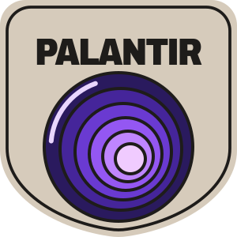
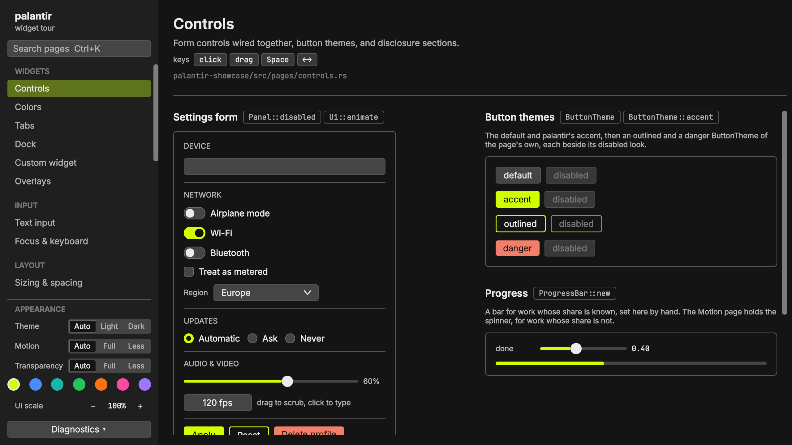
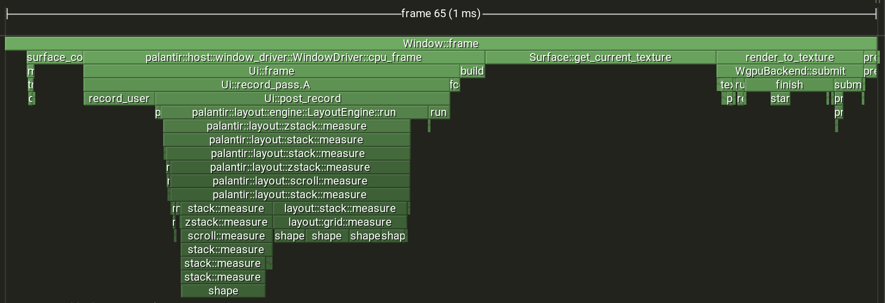

<p align="center">
  
</p>

<p align="center">
  An immediate-mode GUI library for Rust — WPF-style two-pass layout, wgpu renderer.
</p>

<p align="center">
  <a href="https://crates.io/crates/palantir"></a>
  <a href="https://docs.rs/palantir"></a>
  <a href="https://github.com/xorza/palantir/actions/workflows/ci.yml"></a>
  <a href="https://crates.io/crates/palantir"></a>
  <a href="https://github.com/xorza/palantir#license"></a>
</p>

I wanted a cross-platform GUI library — simple yet powerful, WPF-style layout
declaration, good-looking and fast. I made it.

> **Beta.** Feature-rich and usable, but pre-1.0: the public API can still
> change between releases.

## Highlights

- **Immediate-mode authoring** — builder-style widgets that read like prose.
  `record` describes the whole UI every frame; there is no retained widget
  tree to keep in sync.
- **WPF-contract two-pass layout** — measure, then arrange: Hug items shrink
  between their min- and max-content widths as auto table columns do, Fill
  items share the rest as WPF star tracks do, and nothing shrinks below its
  min-content floor.
- **Fast** — a full 2560×1440 app screen costs 18–81 µs of CPU per frame
  when nothing changed and 44–194 µs while the window resizes, and a
  steady-state frame allocates nothing. See [Performance](#performance).
- **Widgets included** — buttons, text and text editing, sliders, checkboxes,
  combo boxes, scroll and pan-zoom views, grids, tabs, a dock, popups, modals,
  tooltips, context menus and a menu bar, all styled from one serializable
  `Theme`.
- **SVG artwork** — icons rasterize at their exact physical size into the
  icon atlas, so they stay crisp at any scale factor and cost nothing until
  first drawn. Gradients and filters included.
- **Materials** — blur, frosted glass and refracting glass on any rect or
  widget chrome, with a luminance ceiling that keeps text on it legible.
- **Keyboard all the way** — `Tab` reaches every widget, dialogs and menus
  trap focus, and widgets take the keys WAI-ARIA gives their role.
- **IME text** — an input method composes inline in a `TextEdit`,
  underlined at the caret, and its candidate list follows the caret.
- **Raw `wgpu` inside a widget** — implement `GpuPaint` and a `GpuView`
  runs your renderer into a widget-sized target, then composites it like any
  image: it clips, rounds and z-orders with everything else.
- **Embeddable** — the winit host owns the window by default; `OffscreenHost`
  renders into a `wgpu::Texture` you supply, inside an event loop you own.
- **Headless UI tests** — `Harness` runs the real UI with no window, and a GPU
  only when a test wants pixels. See [Testing](#testing).

## See it

A short screen recording of the
[showcase](https://github.com/xorza/palantir/tree/master/palantir-showcase), a tour of every
widget:

https://github.com/user-attachments/assets/6ae8305c-dba6-4998-8fb1-9522f9331e02


Built with Palantir: [Darkroom](https://github.com/xorza/Darkroom), a
node-graph editor for image and data pipelines.


## Getting started

```sh
cargo add palantir
```

The default features carry the winit host and the OS clipboard. With
`default-features = false` the only host left is `OffscreenHost`, the build
for an app that already owns its window and event loop.

```rust no_run
use palantir::{
    App, Button, Configure, Panel, Sizing, Text, Ui, WindowToken, WinitHost, WinitHostError, fmt,
};

struct Counter { clicks: u32 }

impl App for Counter {
    // `win` names which window is being drawn; switch on it for multi-window
    // apps. This one has a single window, so it's ignored.
    fn record(&mut self, _win: WindowToken, ui: &mut Ui) {
        Panel::vstack()
            .gap(8.0)
            .size((Sizing::HUG, Sizing::HUG))
            .show(ui, |ui| {
                // `fmt!` formats into the frame's text arena — no `String`.
                Text::new(fmt!(ui, "clicks: {}", self.clicks)).show(ui);
                if Button::new().label("click me").show(ui).clicked() {
                    self.clicks += 1;
                }
            });
    }
}

fn main() -> Result<(), WinitHostError> {
    WinitHost::builder(WindowToken(0))
        .title("counter")
        .build(|_ui, _host| Counter { clicks: 0 })?
        .run()
}
```

For a tour of every widget, run the bundled
[showcase](https://github.com/xorza/palantir/tree/master/palantir-showcase):

```sh
cargo run --profile release-dev -p palantir-showcase
```

**Your own widgets.** The crate root is what an application types;
`palantir::widget` is what a widget is built from. The showcase's
**custom widget** page,
[`palantir-showcase/src/pages/custom_widget.rs`](https://github.com/xorza/palantir/blob/master/palantir-showcase/src/pages/custom_widget.rs),
builds a `Stepper` entirely against the published API.

## Performance

The `frame` bench drives the showcase's first page on a 2560×1440 surface at
2× scale. Each scenario runs two ways: the deviceless **CPU pipeline** (record →
measure → arrange → cascade → damage → encode + compose), and the full
public path through `OffscreenHost`, the **CPU + GPU frame**, with the GPU
drained before the next iteration.

|                     | Apple M5<br>Metal | Raspberry Pi 5<br>V3D, Vulkan | Steam Deck<br>RADV, Vulkan | Intel i9-13980HX<br>RTX 4090 Laptop, Vulkan |
| ------------------- | ----------------: | ----------------------------: | -------------------------: | ------------------------------------------: |
| **CPU pipeline**    |                   |                               |                            |                                             |
| `cached`            |           18.2 µs |                       80.7 µs |                    51.7 µs |                                     22.5 µs |
| `hovering`          |           21.7 µs |                        102 µs |                    64.8 µs |                                     27.1 µs |
| `partial`           |           28.4 µs |                        138 µs |                    87.4 µs |                                     34.0 µs |
| `alternating`       |           31.9 µs |                        150 µs |                     138 µs |                                     38.7 µs |
| `scrolling`         |           34.7 µs |                        155 µs |                    99.0 µs |                                     42.6 µs |
| `resizing`          |           43.9 µs |                        194 µs |                     127 µs |                                     52.5 µs |
| `typing`            |           52.2 µs |                        241 µs |                     154 µs |                                     63.8 µs |
| `theming`           |           70.6 µs |                        343 µs |                     224 µs |                                     99.2 µs |
| **CPU + GPU frame** |                   |                               |                            |                                             |
| `cached`            |           18.3 µs |                       83.2 µs |                    66.9 µs |                                     22.7 µs |
| `hovering`          |            261 µs |                       2.46 ms |                     661 µs |                                      140 µs |
| `partial`           |            276 µs |                       2.74 ms |                     753 µs |                                      152 µs |
| `alternating`       |            348 µs |                       6.73 ms |                    1.04 ms |                                      156 µs |
| `scrolling`         |            315 µs |                       5.49 ms |                     797 µs |                                      171 µs |
| `resizing`          |            318 µs |                       5.27 ms |                     930 µs |                                      185 µs |
| `typing`            |            292 µs |                       2.65 ms |                     894 µs |                                      197 µs |
| `theming`           |            398 µs |                       6.19 ms |                    1.57 ms |                                      373 µs |

- **Scenarios.** `cached` changes nothing, so layout hits its cache and
  damage skips the paint. `hovering` moves the pointer between two widgets,
  one move a frame. `partial` changes one counter, a small damage rect.
  `alternating` takes a scroll step, then a counter tick. `scrolling` moves a
  transform. `resizing` changes the surface size every frame, so every
  measure runs again. `typing` types a character into a focused field, then
  deletes it. `theming` blends two themes at a new phase every frame, so text
  reshapes and rasterizes anew.
- **Run.** Each number is the median of one full run. The Apple M5 runs
  unpinned; every other machine runs pinned to one core.
- **Build.** The x86 build sets `-C target-cpu=x86-64-v3` (see
  [Recommended build flag](#recommended-build-flag)); an aarch64 build sets
  no flag.

The bench screen, the showcase's first page:



The worst-case frame in a Tracy capture of a window resize on an Apple M5:



### Zero per-frame allocation

A steady-state frame allocates nothing after warmup. Per-frame data lives on
retained scratch that keeps its capacity across frames, and the `alloc`
test suite fails on any new per-frame allocation.

### Recommended build flag

Color, corner radii, spacing and shadow geometry are stored as f16. Without
F16C in the target features, each conversion takes a runtime feature check
into a `#[target_feature]` fn that can't inline into its caller — a spill and
a call every time. x86-64-v3 carries F16C, plus AVX2 and FMA:

```toml
# .cargo/config.toml
[target.'cfg(target_arch = "x86_64")']
rustflags = ["-C", "target-cpu=x86-64-v3"]
```

F16C alone is worth **5–8%** on the `frame` bench. The flag moves the CPU
floor to Haswell (2013), so it's the application's call — palantir keeps the
runtime fallback either way. An application that must run on older CPUs can
set `-C target-feature=+f16c` instead, for an Ivy Bridge (2012) floor.

## Testing

### Headless UI tests

`Harness` drives your interface with no window, no GPU and no event loop. It
records frames, feeds synthetic input, and reads the result back. A whole
interaction test costs microseconds, so UI behavior stays a plain `cargo test`.

- **Act like a user** — `click("Save")` by text, `click(id)` by id or
  `click(point)`, `right_click`, `drag_to`, `scroll_lines`, `pinch`,
  `type_text("hi")`, `key("ctrl+z".parse()?)`, `hold_modifiers`.
- **Ask what happened** — a widget's arranged rect and response, the widget at
  a point, the visible widgets and their text, and the clipboard.
- **Own the clock** — step animations frame by frame, or move past the
  double-click interval. Every run is deterministic.
- **Pick the surface** — size, DPI scale, user scale, pixel snap, refresh
  rate. Test a 4K HiDPI layout on any machine.
- **Play it as a person** — `play` runs a list of `Action`s, settling after
  each, and with a GPU (`Harness::builder(size).gpu(gpu)`) `shot` returns the
  window's pixels.

```rust
use palantir::glam::UVec2;
use palantir::{Button, Configure, Harness, Ui, WidgetId};

let inc = WidgetId::from_hash("inc");
let mut clicks = 0_u32;
let mut screen = |ui: &mut Ui| {
    if Button::new().id(inc).label("click me").show(ui).clicked() {
        clicks += 1;
    }
};

let mut h = Harness::new(UVec2::new(400, 200));
h.prime(2, &mut screen);
h.click("click me");
h.frame(&mut screen);

assert_eq!(clicks, 1);
```

### Golden images

For pixels as well as behavior, the `golden` feature adds golden-image
regression tests. `OffscreenHost` renders a frame into a `wgpu::Texture`,
and the comparison reports exactly which pixels moved.

## Not yet implemented

Known gaps, not design rejections:

- **Accessibility** — no AccessKit / screen-reader support yet.
- **Rich text** — one family / size / color per `Text`; no inline spans.
- **Visual caret motion in bidirectional text** — `TextEdit`'s arrow keys
  step graphemes in logical order, so inside a right-to-left run `←` moves
  the caret visually rightward.

## License

Licensed under either of

- [Apache License, Version 2.0](https://github.com/xorza/palantir/blob/master/LICENSE-APACHE)
- [MIT license](https://github.com/xorza/palantir/blob/master/LICENSE-MIT)

at your option.

The bundled Inter and JetBrains Mono faces under `assets/fonts` are licensed
separately under the SIL Open Font License 1.1; their `*-OFL.txt` sit beside
them.
